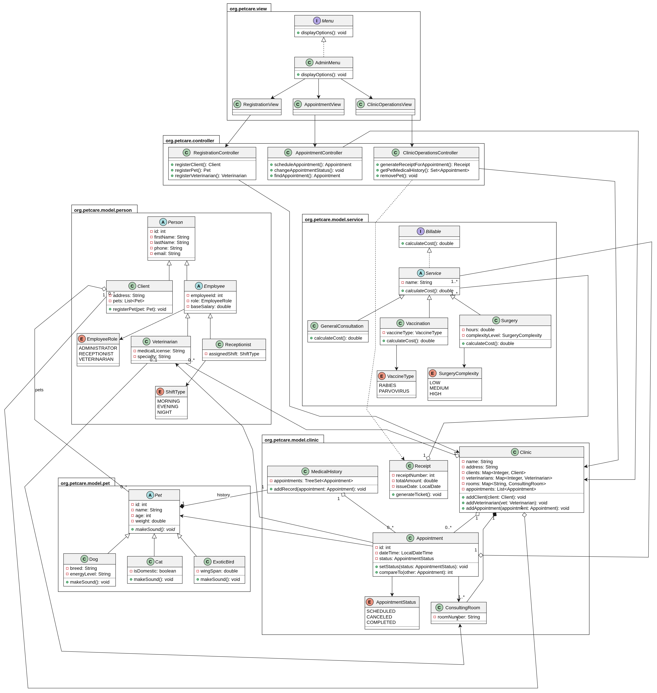

# PetCare — Sistema de gestión para una clínica veterinaria


**PetCare** es una aplicación de consola escrita en Java que resuelve el día a día de una clínica veterinaria: registrar dueños y sus mascotas (perros, gatos y aves exóticas), dar de alta veterinarios, agendar citas en consultorios numerados, atender o cancelar esas citas, calcular lo que se cobra por cada servicio (consulta general, vacunación y cirugía), emitir comprobantes y consultar el historial clínico de cada mascota.

Los datos viven en memoria mientras el programa corre (colecciones de Java); no requiere base de datos, interfaz gráfica ni conexión a internet. El proyecto se desarrolló como ejercicio académico de **Diseño y Programación Orientada a Objetos** y aplica herencia, clases abstractas, interfaces, polimorfismo, agregación, composición y validación de reglas de negocio.

## Tabla de contenido

- [Características](#características)
- [Tecnologías](#tecnologías)
- [Documentación de la API (Javadoc)](#documentación-de-la-api-javadoc)
- [Modelo de la solución](#modelo-de-la-solución)
- [Instalación y ejecución](#instalación-y-ejecución)
- [Ejemplo de uso](#ejemplo-de-uso)
- [Escenario de pruebas](#escenario-de-pruebas)
- [Reglas de negocio](#reglas-de-negocio)
- [Alcance y limitaciones](#alcance-y-limitaciones)
- [Reflexión](#reflexión)
- [Uso de IA](#uso-de-ia)
- [Licencia](#licencia)
- [Autor](#autor)

## Características

- Registro de **dueños** y **mascotas** (perro, gato, ave exótica), cada especie con sus datos propios y su sonido.
- Registro de **veterinarios**, que se incorporan a la clínica y reciben un consultorio fijo.
- **Citas** con mascota, veterinario, consultorio, fecha y hora, y estado (`SCHEDULED`, `COMPLETED`, `CANCELED`).
- **Cobro** polimórfico: cada servicio calcula su propio costo.
- **Comprobantes** con folio consecutivo, y totales cobrados por veterinario y por mascota.
- **Historial clínico** ordenado cronológicamente por mascota.
- Baja de una mascota junto con su historial.
- Validación de entradas incorrectas en consola sin que el programa se cierre.

## Tecnologías

| Herramienta | Uso |
| --- | --- |
| **Java** — OpenJDK 25.0.5.0.2 (2026-10-22 LTS) | Lenguaje y plataforma de ejecución |
| **Maven** (`pom.xml`) | Compilación y empaquetado |
| **Git / GitHub** | Control de versiones |
| **release-please** + GitHub Actions | Versionado automático y changelog |

## Documentación de la API (Javadoc)

La documentación completa de clases, métodos y paquetes está publicada aquí:

👉 **<https://moisestorres24.github.io/PetCare/api/>**

## Modelo de la solución



> El archivo fuente editable del diagrama está en `docs/diagramas/`.

### Herencia

Hay tres jerarquías, cada una con una clase padre abstracta que concentra lo común:

| Jerarquía | Padre | Hijas | Qué comparten |
| --- | --- | --- | --- |
| Personas | `Person` (abstracta) | `Client`, `Employee` (abstracta) | Nombre, apellido, teléfono y correo |
| Empleados | `Employee` (abstracta) | `Veterinarian`, `Receptionist` | Identificador laboral, rol y sueldo base |
| Mascotas | `Pet` (abstracta) | `Dog`, `Cat`, `ExoticBird` | Nombre, edad, peso, dueño e historial; cada hija implementa `makeSound()` |
| Servicios | `Service` (abstracta) | `GeneralConsultation`, `Vaccination`, `Surgery` | Nombre del servicio; cada hija implementa `calculateCost()` |

Se eligió herencia porque en todos los casos la relación es de tipo **"es un"** (un perro *es una* mascota, un veterinario *es un* empleado) y el comportamiento común se escribe una sola vez en el padre.

### Interfaces

- **`Billable`** declara `calculateCost()`. `Service` la implementa y sus tres hijas (consulta, vacunación y cirugía) calculan el costo cada una a su manera, así que el cobro total puede recorrer una `List<Billable>` sin preguntar el tipo con `instanceof`.
- **`Menu`** define el contrato de un menú interactivo (`displayOptions()` y `readUserInput()`); `AdminMenu` la implementa y `Main` solo depende de la interfaz.

### Agregación, composición y asociación

| Relación | Tipo | Por qué |
| --- | --- | --- |
| `Clinic` ◇— `Veterinarian` | **Agregación** | El veterinario se crea fuera de la clínica, se recibe ya creado (`addVeterinarian`) y sigue existiendo si la clínica cierra; incluso podría trabajar en otra. |
| `Clinic` ◆— `ConsultingRoom` | **Composición** | La clínica crea sus consultorios numerados en `initializeRooms()`; no se comparten y desaparecen con ella. |
| `Pet` ◆— `MedicalHistory` | **Composición** | La mascota crea su historial en el constructor; el historial no tiene sentido sin ella y se elimina junto con la mascota. |
| `Appointment` → `Pet`, `Veterinarian`, `ConsultingRoom` | **Asociación** | Una cita solo *relaciona* objetos independientes: si la cita se elimina, mascota, veterinario y consultorio siguen existiendo. |
| `Client` ↔ `Pet` | **Asociación** | El cliente conoce sus mascotas (`pets`) y la mascota conoce a su dueño (`owner`). |
| `Appointment` → `Service` | **Asociación** | La cita guarda la lista de servicios que se van a cobrar. |


## Instalación y ejecución

### Requisitos

- **JDK 25** (o superior). Para comprobarlo:

  ```bash
  java -version
  ```

- **Maven 3.9+** (opcional si compilas directamente con `javac`).
- **Git**.

### Pasos

1. Clona el repositorio y entra a la carpeta:

   ```bash
   git clone https://github.com/MoisesTorres24/PetCare.git
   cd PetCare
   ```

2. Compila el proyecto:

   ```bash
   mvn clean compile
   ```

3. Ejecuta la aplicación:

   ```bash
   java -cp target/classes org.petcare.app.Main
   ```

### Menú de la aplicación

| Opción | Acción |
| --- | --- |
| 1 | Registrar dueño y mascota (perro, gato o ave exótica) |
| 2 | Registrar una mascota para un dueño ya existente |
| 3 | Registrar veterinario y asignarlo a la clínica |
| 4 | Agendar una cita |
| 5 | Atender o cancelar una cita |
| 6 | Generar el comprobante de una cita atendida |
| 7 | Consultar el historial clínico de una mascota |
| 8 | Listar todas las mascotas y su sonido (polimorfismo) |
| 9 | Ver el total cobrado por veterinario (y por mascota) |
| 10 | Dar de baja una mascota con su historial |
| 11 | Salir |


## Ejemplo de uso

Sesión real con el menú de consola: se registra un dueño con su perro y un veterinario, se agenda una cita con consulta y vacuna, se intenta reservar la misma hora (error de regla de negocio), se atiende la cita, se genera el comprobante y se listan las mascotas con su sonido. Se omiten los menús repetidos para abreviar.

```text
=== SISTEMA DE GESTIÓN VETERINARIA PETCARE ===

===== MENÚ PRINCIPAL =====
1. Registrar dueño y mascota
2. Registrar mascota
3. Registrar veterinario y asignarlo a la clínica
4. Agendar una cita
5. Atender o cancelar una cita
6. Generar el comprobante de una cita atendida
7. Consultar el historial clínico de una mascota
8. Listar todas las mascotas y su sonido
9. Ver el total cobrado por veterinario
10. Dar de baja una mascota
11. Salir
Opción: 1
=== Registrando dueño y mascota ===
Nombre: Ana
Apellido: López
Teléfono: 5551110000
Correo: ana@mail.com
Dirección: Calle 1
Dueño registrado exitosamente con ID: 1
Tipo de mascota: 1) Perro, 2) Gato o 3) Ave exotica
Opción: 1
Nombre de la mascota: Rocky
Edad: 4
Peso: 18.5
Raza: Labrador
Nivel de energía: Alto
Mascota registrada exitosamente con ID: 1

[... menú principal ...]
Opción: 3
=== Registrando veterinario ===
Nombre: Carlos
Apellido: Ramírez
Teléfono: 5553330000
Correo: carlos@petcare.com
Cédula profesional: CED-1001
Especialidad: Cirugía
Veterinario registrado exitosamente con ID: 1

[... menú principal ...]
Opción: 4
Mascotas:
1 - Rocky
Veterinarios:
1 - Carlos Ramírez - Consultorio 1
ID de la mascota: 1
ID del veterinario: 1
Año: 2026
Mes: 11
Día: 10
Hora: 9
Minutos: 0
Consulta general agregada.
¿Quieres agregar una vacuna? (s/n): s
Vacuna: 1) Rabia, 2) Parvovirus
Opción: 1
¿Quieres agregar una cirugía? (s/n): n
Total de la cita: 850.0
Cita agendada con ID: 1

[... menú principal ...]
Opción: 4
Mascotas:
1 - Rocky
Veterinarios:
1 - Carlos Ramírez - Consultorio 1
ID de la mascota: 1
ID del veterinario: 1
Año: 2026
Mes: 11
Día: 10
Hora: 9
Minutos: 0
Consulta general agregada.
¿Quieres agregar una vacuna? (s/n): n
¿Quieres agregar una cirugía? (s/n): n
Total de la cita: 500.0
Error: El veterinario ya tiene una cita a esa hora

[... menú principal ...]
Opción: 5
Citas registradas:
ID: 1 | Mascota: Rocky | Veterinario: Carlos Ramírez | Fecha: 2026-11-10T09:00 | Estado: SCHEDULED
ID de la cita: 1
¿Qué deseas hacer con la cita?
1. Atender cita
2. Cancelar cita
Opción: 1
La cita fue marcada como atendida.

[... menú principal ...]
Opción: 6
=== Generar comprobante de cita atendida ===
Cita ID: 1 | Fecha: 2026-11-10T09:00 | Mascota: Rocky | Veterinario: Carlos Ramírez | Consultorio: 1 | Estado: COMPLETED
ID de la cita atendida: 1
=========================================
       COMPROBANTE DE PAGO #1
Fecha de emisión: 2026-11-03
-----------------------------------------
Servicios cobrados:
 - Consulta General: $500.0
 - Vacunación: $350.0
-----------------------------------------
TOTAL A PAGAR: $850.0
=========================================

[... menú principal ...]
Opción: 8
=== Listado de mascotas y su sonido ===
ID: 1 | [Perro] Nombre: Rocky | Edad: 4 años | Peso: 18.5 kg | Raza: Labrador | Energía: Alto | Dueño: Ana López -> Sonido: ¡Guau, guau!

[... menú principal ...]
Opción: 11
Saliendo del sistema...
```

## Escenario de pruebas

**Código de la prueba** — `src/test/java/Test.java`

```java
import org.petcare.controller.AppointmentController;
import org.petcare.controller.ClinicOperationsController;
import org.petcare.controller.RegistrationController;
import org.petcare.model.clinic.Appointment;
import org.petcare.model.clinic.AppointmentStatus;
import org.petcare.model.clinic.Clinic;
import org.petcare.model.person.Client;
import org.petcare.model.person.Veterinarian;
import org.petcare.model.pet.Pet;
import org.petcare.model.service.GeneralConsultation;
import org.petcare.model.service.Surgery;
import org.petcare.model.service.SurgeryComplexity;
import org.petcare.model.service.Vaccination;
import org.petcare.model.service.VaccineType;

import java.time.LocalDateTime;
import java.util.Arrays;
import java.util.List;


public class Test {
    static void main(String[] args) {
        // Instanciamos la clínica y sus tres controladores
        Clinic clinic = new Clinic("PetCare", 5);
        RegistrationController reg = new RegistrationController(clinic);
        AppointmentController appCtrl = new AppointmentController(clinic);
        ClinicOperationsController ops = new ClinicOperationsController(clinic);

        // 1. Registrar dos dueños y tres mascotas (un perro, un gato y un ave)
        Client c1 = reg.registerClient("Carlos", "Rivera", "9211112233", "carlos@gmail.com", "Centro");
        Client c2 = reg.registerClient("Elena", "Gómez", "9214445566", "elena@gmail.com", "Norte");
        Pet dog = reg.registerDog(c1.getId(), "Max", 4, 18.5, "Pastor Alemán", "Alta");
        Pet cat = reg.registerCat(c1.getId(), "Luna", 2, 4.2, true);
        Pet bird = reg.registerExoticBird(c2.getId(), "Kiwi", 1, 0.4, 28.0);

        // 2. Registrar dos veterinarios
        Veterinarian v1 = reg.registerVeterinarian("Roberto", "Sánchez", "9210001", "roberto@petcare.com", "CED-01", "General");
        Veterinarian v2 = reg.registerVeterinarian("Laura", "Martínez", "9210002", "laura@petcare.com", "CED-02", "Cirugía");

        // 3. Agendar tres citas y atender dos (calculando consulta, vacunación y cirugía)
        Appointment a1 = appCtrl.scheduleAppointment(dog, v1, LocalDateTime.of(2026, 11, 10, 10, 0),
                Arrays.asList(new GeneralConsultation(), new Vaccination(VaccineType.RABIES)));
        Appointment a2 = appCtrl.scheduleAppointment(cat, v2, LocalDateTime.of(2026, 11, 10, 12, 0),
                List.of(new Surgery(2.0, SurgeryComplexity.MEDIUM)));
        Appointment a3 = appCtrl.scheduleAppointment(bird, v1, LocalDateTime.of(2026, 11, 11, 9, 0),
                List.of(new GeneralConsultation()));

        // 4. Atendemos las dos primeras citas e imprimimos sus comprobantes con el costo total
        appCtrl.changeAppointmentStatus(a1.getId(), AppointmentStatus.COMPLETED);
        appCtrl.changeAppointmentStatus(a2.getId(), AppointmentStatus.COMPLETED);
        ops.generateReceiptForAppointment(a1.getId()).generateTicket();
        ops.generateReceiptForAppointment(a2.getId()).generateTicket();

        // 5. Intentar agendar una cita que viole una regla de negocio y mostrar el error
        try {
            // Misma fecha, hora y veterinario que la cita a3 (que sigue programada)
            appCtrl.scheduleAppointment(dog, v1, a3.getDateTime(), List.of(new GeneralConsultation()));
        } catch (IllegalArgumentException e) {
            System.out.println("Error: " + e.getMessage());
        }

        // 6. Listar las mascotas llamando a makeSound() para mostrar el polimorfismo
        System.out.println("\n=== Mascotas y sonidos ===");
        for (Pet pet : ops.getAllPets()) {
            System.out.print(pet.getName() + ": ");
            pet.makeSound();
        }

        // 7. Mostrar el total cobrado y consultar un historial clínico
        System.out.println("\n=== Total cobrado por veterinario ===");
        System.out.println("Dr. " + v1.getFirstName() + ": $" + ops.calculateTotalCollectedByVeterinarian(v1.getEmployeeId()));
        System.out.println("Dra. " + v2.getFirstName() + ": $" + ops.calculateTotalCollectedByVeterinarian(v2.getEmployeeId()));

        System.out.println("\n=== Historial clínico de " + dog.getName() + " ===");
        for (Appointment record : ops.getPetMedicalHistory(dog.getId())) {
            System.out.println(record);
        }
        System.out.println("Total cobrado a " + dog.getName() + ": $" + ops.calculateTotalCollectedByPet(dog.getId()));
    }
}
```

**Salida de la ejecución**

```text
/var/home/mt/.jdks/ms-25.0.5.0.2/bin/java -javaagent:/var/home/mt/.local/share/JetBrains/Toolbox/apps/intellij-idea/lib/idea_rt.jar=42861 -Dfile.encoding=UTF-8 -Dsun.stdout.encoding=UTF-8 -Dsun.stderr.encoding=UTF-8 -classpath /var/home/mt/Escritorio/PetCare/target/test-classes:/var/home/mt/Escritorio/PetCare/target/classes Test
=========================================
       COMPROBANTE DE PAGO #1
Fecha de emisión: 2026-11-02
-----------------------------------------
Servicios cobrados:
 - Consulta General: $500.0
 - Vacunación: $350.0
-----------------------------------------
TOTAL A PAGAR: $850.0
=========================================
=========================================
       COMPROBANTE DE PAGO #2
Fecha de emisión: 2026-11-02
-----------------------------------------
Servicios cobrados:
 - Cirugía: $2400.0
-----------------------------------------
TOTAL A PAGAR: $2400.0
=========================================
Error: El veterinario ya tiene una cita a esa hora

=== Mascotas y sonidos ===
Max: ¡Guau, guau!
Luna: ¡Miau, miau!
Kiwi: ¡Pío, pío, trino exótico!

=== Total cobrado por veterinario ===
Dr. Roberto: $850.0
Dra. Laura: $2400.0

=== Historial clínico de Max ===
Cita ID: 1 | Fecha: 2026-11-10T10:00 | Mascota: Max | Veterinario: Roberto Sánchez | Consultorio: 1 | Estado: COMPLETED
Total cobrado a Max: $850.0

Process finished with exit code 0
```

## Reglas de negocio

| # | Regla | Dónde se valida | Mensaje |
| --- | --- | --- | --- |
| 1 | Peso y edad de una mascota mayores que cero | `model/pet/Pet.java` → `setAge` (L93) y `setWeight` (L110), también usados por el constructor | `la edad debe ser mayor que cero` / `el peso debe ser mayor que cero` |
| 2 | Un veterinario no puede tener dos citas programadas a la misma hora | `controller/AppointmentController.java` → `isVetAvailable` (L135), llamado en `scheduleAppointment` (L48) | `El veterinario ya tiene una cita a esa hora` |
| 3 | Una cita cancelada no puede marcarse como atendida | `controller/AppointmentController.java` → `validateStatus` (L170) y `model/clinic/Appointment.java` → `setStatus` (L146) | `Una cita cancelada no puede ser atendida` |
| 4 | Un consultorio no puede usarse en dos citas al mismo tiempo | `controller/AppointmentController.java` → `isRoomAvailable` (L153), llamado en `scheduleAppointment` (L52) | `El consultorio ya está ocupado en otra cita a esa misma hora` |
| 5 | Los costos nunca pueden ser negativos | `util/Validatable.java` → `nonNegativeDecimal` (L25); `model/clinic/Receipt.java` (L45); `controller/ClinicOperationsController.java` → `calculateBillableTotal` (L183) | `el <campo> no puede ser negativo` / `El costo no puede ser negativo` |
| 6 | Todo cobro se puede consultar por mascota y por veterinario | `controller/ClinicOperationsController.java` → `calculateTotalCollectedByPet` (L111) y `calculateTotalCollectedByVeterinarian` (L90) | — |

Además, todos los datos de texto son obligatorios (`Validatable.requiredText`) y los menús rechazan texto donde se espera un número o una opción fuera de rango (`util/InputHelper.java`).

## Alcance y limitaciones

- Los datos se guardan **en memoria**: al cerrar el programa se pierden.
- La clínica se crea con **5 consultorios** (`Main`), y cada veterinario recibe uno fijo, por lo que se pueden registrar hasta 5 veterinarios.
- La clase `Receptionist` está modelada, pero el menú actual es el de administrador y todavía no la usa.
- Una cita ya atendida deja de bloquear el horario del veterinario y del consultorio; solo las citas `SCHEDULED` cuentan para las reglas 2 y 4.

## Reflexión

Este proyecto me ayudó a darme cuenta de la importancia de generar documentación previa como el diagrama de clases y hacerlo bien. Me pasó que yo hice una primera versión, pero no tomé en cuenta todas las funciones que debía cumplir mi proyecto y solo me centré en hacer las principales clases.

* **¿Qué aprendí?**
Mi mayor aprendizaje fue sobre el uso de Git y GitHub para automatizar cosas, el crear ramas y commits. Aprendí a automatizar un repositorio que al momento de hacer un merge de un pull detecte el tipo de commit y me genere un release automáticamente. Aprendí mucho sobre los temas de composición y agregación.
* **¿Qué fue lo más difícil?**
El tema de las validaciones y excepciones.
* **¿Qué mejoraría?**
Si ahorita pudiera hacerlo, me centraría en dejar bien en claro los casos de uso desde el principio y no volver a cometer errores, así como respetar las convenciones de commits.

## Uso de IA
Usé la IA para casi todo el desarrollo del proyecto, principalmente al momento de crear comentarios y documentación Javadoc en mis códigos, también me ayudó a refactorizar muchas funciones de mi código y me ayudó a realizar la lógica de los métodos más complicados, especialmente los controladores y viewers, así como en el tema de manejo de excepciones. Ocupé la IA también para realizar este documento. Tampoco delegué mi trabajo a la IA y espero en mis futuros proyectos usar la IA de mejor manera.

## Licencia

Este proyecto se distribuye bajo la licencia **MIT**. Puedes cosultarla en: [`LICENSE`](LICENSE).

## Autor

- **Nombre:** Moises Gerónimo Torres González
- **GitHub:** [@MoisesTorres24](https://github.com/MoisesTorres24)
- **Repositorio:** <https://github.com/MoisesTorres24/PetCare>